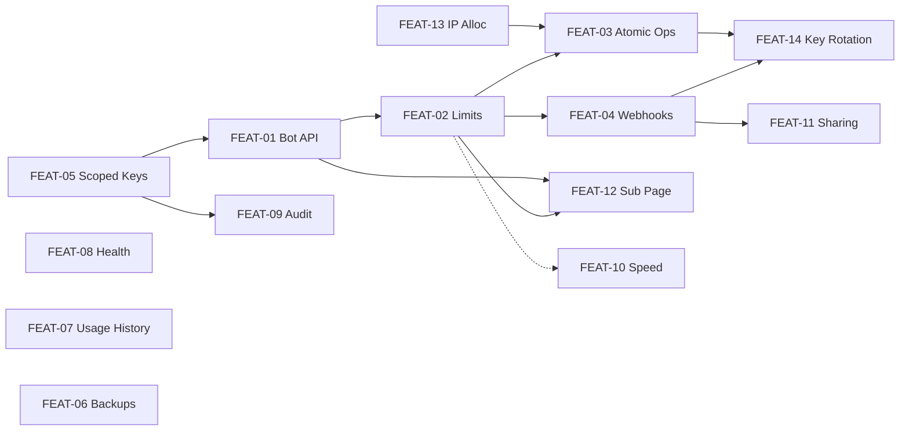

# اسناد طراحی فیچرها (Design Specs)

> این پوشه برای هر پیشنهاد سند [09-Feature-Proposals.md](../09-Feature-Proposals.md) یک سند طراحی کامل دارد: مسئله، اهداف، مدل داده، API، امنیت، مهاجرت، تغییرات ربات OxBot، UI، تست، استقرار و برآورد.
> برنامه‌ی زمان‌بندی اجرای همه‌ی اصلاحات و فیچرها: [10-Implementation-Roadmap.md](../10-Implementation-Roadmap.md)

## فهرست

| سند | اولویت | حجم | وابستگی |
|------|---------|------|----------|
| [FEAT-01 — API سبک برای ربات](FEAT-01-Lightweight-Bot-API.md) | ⭐⭐⭐ | S | قراردادهای مشترک (همین سند) |
| [FEAT-02 — محدودیت‌های دائمی Peer (پلن)](FEAT-02-Peer-Limits.md) | ⭐⭐⭐ | M-L | FEAT-01، رفع BUG-11 |
| [FEAT-03 — عملیات اتمیک و Idempotent](FEAT-03-Atomic-Idempotent-Operations.md) | ⭐⭐⭐ | M | FEAT-01، FEAT-02، FEAT-13 |
| [FEAT-04 — Webhookهای امضاشده](FEAT-04-Signed-Event-Webhooks.md) | ⭐⭐ | S-M | FEAT-02 (برای رویدادهای محدودیت) |
| [FEAT-05 — API Key با محدوده](FEAT-05-Scoped-API-Keys.md) | ⭐⭐⭐ | M | — (پایه‌ی امنیتی بقیه) |
| [FEAT-06 — بکاپ امن و خودکار](FEAT-06-Secure-Backups.md) | ⭐⭐ | M-L | رفع GB-01..05 |
| [FEAT-07 — تاریخچه‌ی مصرف اینترفیس](FEAT-07-Interface-Usage-History.md) | ⭐⭐ | S-M | رفع TU-01 |
| [FEAT-08 — Health، متریک و هشدار](FEAT-08-Health-Metrics-Alerts.md) | ⭐⭐ | S | — |
| [FEAT-09 — Audit Log](FEAT-09-Audit-Log.md) | ⭐⭐ | S | FEAT-05 (برچسب کلیدها) |
| [FEAT-10 — محدودیت سرعت per-peer](FEAT-10-Per-Peer-Speed-Limit.md) | ⭐ | M-L | FEAT-02 (اختیاری) |
| [FEAT-11 — تشخیص اشتراک‌گذاری اکانت](FEAT-11-Account-Sharing-Detection.md) | ⭐ | S-M | FEAT-04 |
| [FEAT-12 — صفحه‌ی اشتراک کاربر](FEAT-12-Subscription-Page.md) | ⭐ | S-M | FEAT-01، FEAT-02 |
| [FEAT-13 — تخصیص IP توسط پنل](FEAT-13-Panel-IP-Allocation.md) | ⭐⭐ | S | — |
| [FEAT-14 — چرخش کلید اینترفیس](FEAT-14-Interface-Key-Rotation.md) | ⭐⭐ | M | FEAT-03، FEAT-04 |



---

## قراردادهای مشترک همه‌ی فیچرها

این قواعد یک بار اینجا تعریف می‌شوند و همه‌ی اسناد به آن‌ها ارجاع می‌دهند.

### ۱. نسخه‌بندی API
- همه‌ی endpointهای جدید زیر **`/api/v2/`** هستند و در یک Blueprint جدا پیاده می‌شوند (`src/api_v2.py`، مشابه الگوی [client.py](../../src/client.py) با `createApiV2Blueprint(...)`).
- endpointهای فعلی (`/api/...`) **دست نمی‌خورند** تا ربات فعلی و UI از کار نیفتند. ربات به‌تدریج مهاجرت می‌کند.

### ۲. احراز هویت
- همان دو روش فعلی: session ادمین یا هدر `wg-dashboard-apikey`.
- هر endpoint v2 یک **scope** لازم دارد ([FEAT-05](FEAT-05-Scoped-API-Keys.md)). تا وقتی FEAT-05 پیاده نشده، همه‌ی کلیدها `admin` حساب می‌شوند.
- وضعیت احراز هر درخواست در `flask.g` نگه داشته می‌شود، نه متغیر سراسری ([SEC-01](../02-Security-Vulnerabilities.md#sec-01)).

### ۳. قالب پاسخ
همان پوشش فعلی، به‌علاوه‌ی `error_code` ماشین‌خوان و کد HTTP درست:
```json
{ "status": false, "message": "Peer not found", "error_code": "NOT_FOUND", "data": null }
```

| `error_code` | HTTP | معنی |
|--------------|------|------|
| `VALIDATION_ERROR` | 400 | ورودی نامعتبر؛ `data.fields` جزئیات را دارد |
| `UNAUTHORIZED` | 401 | بدون احراز/کلید نامعتبر یا منقضی |
| `FORBIDDEN_SCOPE` | 403 | کلید اجازه‌ی این عملیات یا این اینترفیس را ندارد |
| `NOT_FOUND` | 404 | کانفیگ/peer پیدا نشد |
| `AMBIGUOUS` | 409 | جستجو با نام بیش از یک نتیجه داشت |
| `CONFLICT` | 409 | IP/کلید تکراری، یا وضعیت ناسازگار |
| `LIMIT_EXCEEDED` | 409 | محدودیت peer هنوز رد شده (FEAT-02) |
| `IDEMPOTENCY_MISMATCH` | 422 | همان Idempotency-Key با بدنه‌ی متفاوت |
| `IN_PROGRESS` | 409 | درخواستی با همین کلید در حال اجراست |
| `BUSY` | 503 | قفل کانفیگ در زمان مقرر گرفته نشد؛ دوباره تلاش کنید |
| `MAINTENANCE` | 503 | ریستور/نگهداری در جریان است |
| `INTERNAL` | 500 | خطای پیش‌بینی‌نشده (جزئیات فقط در لاگ) |

پاسخ‌های 503 هدر `Retry-After` دارند.

### ۴. شناسه‌ها
- peer با **public key** شناخته می‌شود (`id`). چون کاراکترهای `+` و `/` دارد، **هرگز در path** نمی‌آید؛ فقط در query string (URL-encoded) یا بدنه‌ی JSON.
- کانفیگ با نامش (`configuration`).

### ۵. زمان و واحد
- همه‌ی زمان‌ها در **UTC** ذخیره و با فرمت ISO-8601 و پسوند `Z` برگردانده می‌شوند (`2026-10-14T18:30:00Z`). ورودی می‌تواند ISO با offset یا Unix epoch (عدد) باشد. این مشکل [BOT-07](../06-OxBot-Integration.md#bot-07) را ریشه‌ای حل می‌کند.
- حجم‌ها در v2 به‌صورت **عدد صحیح بایت** (`*_bytes`). دیتابیس فعلی گیگابایت اعشاری نگه می‌دارد؛ تبدیل: `round(gb * 1024**3)`.

### ۶. هم‌زمانی
- هر عملیات تغییردهنده روی یک کانفیگ داخل `config.lock` (همان `ProcessLock` فعلی) اجرا می‌شود. اگر قفل در ۱۰ ثانیه گرفته نشد ← `BUSY` (به‌جای انتظار ۳۰ ثانیه‌ای و 500).
- عملیات گروهی فقط **یک بار** `wg-quick save` انجام می‌دهند.

### ۷. تغییرات دیتابیس
- جداول جدید با `metadata.create_all` ساخته می‌شوند (idempotent). ستون‌های جدید روی جداول موجود با الگوی [EnsureDatabaseIntegrity](../../src/modules/DashboardConfig.py#L109-L162) اضافه می‌شوند.
- جداولی که باید با peerها در یک تراکنش تغییر کنند (مثل محدودیت‌ها) در **همان دیتابیس `wgdashboard`** قرار می‌گیرند. (job ها در `wgdashboard_job` هستند و به همین دلیل نمی‌توانند با peer اتمیک باشند.)
- هر تغییر schema یک شماره‌ی نسخه در جدول `SchemaVersion` ثبت می‌کند تا ریستور بکاپ‌های قدیمی/جدید قابل تشخیص باشد.

### ۸. پرچم فعال‌سازی
هر فیچر یک کلید در بخش جدید `[Features]` فایل ini دارد (مثلاً `peer_limits = false`) تا بشود بدون deploy مجدد خاموشش کرد.

### ۹. تست
- تست واحد با `pytest` و SQLite موقت (`tmp_path`)؛ فراخوانی‌های `wg`/`wg-quick` با یک fake جایگزین می‌شوند (الگوی [tests/test_peer_auto_heal.py](../../tests/test_peer_auto_heal.py)).
- تست یکپارچه روی یک VM/کانتینر لینوکس با WireGuard واقعی قبل از استقرار روی سرور اصلی.

### ۱۰. استقرار
قبل از هر استقرار: Global Backup دستی (pin‌شده)، استقرار روی ساعت کم‌ترافیک، و نگه داشتن نسخه‌ی قبلی برای rollback (`git checkout <tag>` + `systemctl restart wg-dashboard`).
